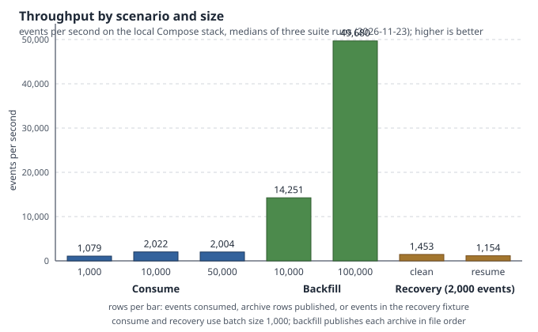

# API Usage Streaming Pipeline

Reconcile synthetic API usage events from one Kafka partition into daily request and token totals in PostgreSQL. Each batch commits accepted facts, one outcome per delivered record, and the next Kafka offset in a single transaction.

## Run the local demo

From the repository root, with Docker Compose and uv installed:

```bash
uv sync --locked
docker compose --env-file /dev/null -p api-usage-demo up -d --wait
uv run --locked usage-stream setup
uv run --locked usage-stream publish-fixture
uv run --locked usage-stream consume --until-high-watermark --timeout-seconds 30
```

Kafka can take a moment to accept requests after the container starts. If setup reports a broker error during startup, rerun setup once Kafka is ready. Setup preserves a matching checkpoint when run again.

Query both views as the reporting login:

```bash
docker compose --env-file /dev/null -p api-usage-demo exec -T \
  -e PGPASSWORD=usage-reporting-local postgres \
  psql -h 127.0.0.1 -U reporting_reader -d usage -v ON_ERROR_STOP=1 <<'SQL'
BEGIN ISOLATION LEVEL REPEATABLE READ READ ONLY;
SELECT * FROM reporting.daily_usage ORDER BY usage_day;
SELECT * FROM reporting.delivery_reconciliation;
COMMIT;
SQL
```

| UTC day | Requests | Input tokens | Output tokens |
| --- | ---: | ---: | ---: |
| 2026-11-21 | 1 | 5 | 1 |
| 2026-11-22 | 2 | 30 | 6 |

The first run has six deliveries: three accepted, one duplicate, one conflict, and one invalid. Running consume again reaches the same offset and leaves the views unchanged. Running the publisher again appends six deliveries and preserves the usage totals. Before publishing, `publish-fixture` checks that the topic exists with the expected configuration and exits 3 otherwise. If publication is uncertain, it exits 5 and reports the confirmed lower bound; rerun the whole fixture, or rebuild into a new topic and database if a conflicting row may have been published, because the first valid delivery for an event ID wins and a rerun cannot replace it.

Stop the demo after checking the results:

```bash
docker compose --env-file /dev/null -p api-usage-demo stop
```

## Command reference

All commands share global options given before the command name:

```text
usage-stream [--broker HOST:PORT] [--topic NAME] [--pipeline NAME]
             [--installer-dsn DSN] [--consumer-dsn DSN] COMMAND ...
```

| Option | Environment variable | Default |
| --- | --- | --- |
| `--broker` | `USAGE_BROKER` | `127.0.0.1:19092` (the port comes from `USAGE_KAFKA_PORT` when set) |
| `--topic` | `USAGE_TOPIC` | `api-usage` |
| `--pipeline` | `USAGE_PIPELINE` | `usage` |
| `--installer-dsn` | `USAGE_INSTALLER_DSN` | loopback `usage` database on `USAGE_POSTGRES_PORT` (default `15432`) as the `installer` role |
| `--consumer-dsn` | `USAGE_CONSUMER_DSN` | loopback `usage` database on `USAGE_POSTGRES_PORT` (default `15432`) as the `usage_consumer` role |

`USAGE_KAFKA_PORT` and `USAGE_POSTGRES_PORT` change both the Compose ports and the CLI's loopback defaults. Broker selection takes the first available value from `--broker`, `USAGE_BROKER`, and the loopback default. `setup` connects to PostgreSQL with the installer DSN and `consume` with the consumer DSN; `publish-fixture` and `backfill` talk only to Kafka. Keep the supplied demo credentials on loopback.

### setup

```bash
uv run --locked usage-stream setup
```

On a fresh database, creates the topic when missing. It then checks the topic configuration and binds the PostgreSQL checkpoint to the topic ID and partition; if an existing checkpoint points at a missing, replaced, or truncated topic, it exits 3. Running it again preserves a matching checkpoint.

### publish-fixture

```bash
uv run --locked usage-stream publish-fixture
```

Publishes the seeded fixture deliveries with their event IDs as keys. Requires the topic to exist with the expected configuration, and exits 3 otherwise. If publication is uncertain, exits 5 and prints the confirmed lower bound; see [Run the local demo](#run-the-local-demo) for the rerun rule.

### backfill

```bash
uv run --locked usage-stream backfill --file PATH --manifest PATH
```

Validates the JSONL archive and its manifest, then publishes the validated bytes in file order. A validation failure exits 2 and publishes nothing; a missing or incompatible topic exits 3 before any record is sent. See [Backfill a dated archive](#backfill-a-dated-archive).

### consume

```text
uv run --locked usage-stream consume [--until-high-watermark]
                                     [--timeout-seconds SECONDS] [--batch-size N]
```

Follows the topic, or with `--until-high-watermark` processes up to the offset captured at startup. `--batch-size` defaults to 100 and accepts 1 through 1,000; `--timeout-seconds` must be finite and positive. A bounded run defaults to 30 seconds when `--timeout-seconds` is omitted, and `--timeout-seconds` also caps a follow-mode run, which then exits 6 at the deadline. Invalid values exit 2. Stop a follow-mode run early with Ctrl+C (exit 130).

### Exit codes

| Code | Meaning | Raised by |
| ---: | --- | --- |
| 0 | Success | all commands |
| 2 | Invalid arguments, or an archive or manifest that cannot be read or fails validation (nothing is published) | all commands; archive/manifest rejection only `backfill` |
| 3 | Unsafe or missing source: a missing or incompatible topic, a missing checkpoint (run `setup` first), a changed topic identity, or a saved offset outside the broker bounds | all commands |
| 4 | Stale checkpoint: another worker committed from the same offset first and wrote the batch | `consume` |
| 5 | Operation failure (Kafka, PostgreSQL, or a driver timeout), or uncertain publication with the confirmed lower bound printed | all commands |
| 6 | Consume deadline reached (`--timeout-seconds`, bounded or follow mode); committed batches and the checkpoint are kept, so a retry resumes | `consume` |
| 130 | Interrupted with Ctrl+C; an interrupted publisher may already have sent part of its rows | all commands |

A topic created milliseconds earlier may not have propagated its topic metadata or partition leadership to the broker yet, so each source-check broker lookup retries those transient propagation errors for up to five seconds before exiting 3 ([ADR 0003](docs/decisions/0003-leader-propagation-retry.md)); a topic or leader that stays unavailable still fails closed.

## Source and recovery

- Setup binds the PostgreSQL checkpoint to the Kafka topic ID and partition. Consume starts at the saved offset with Kafka offset commits disabled. If the binding or broker bounds change, the command stops and reports the failure.
- The first valid delivery for an event ID wins. Exact repeats after UTC normalization become duplicates. Changed values become conflicts. Invalid deliveries leave the ID available for a later valid record.
- Run `usage-stream consume` to follow the topic or use `--until-high-watermark` to process up to the offset captured at startup; see [consume](#consume) for options and defaults.
- See [Exit codes](#exit-codes) for the full table. A bounded-consume timeout (exit 6) can leave committed deliveries and an advanced checkpoint, so a retry resumes from that checkpoint. A follow-mode run stops with Ctrl+C (exit 130).
- Each batch commits its facts, delivery outcomes, and next offset together. A consumer killed before the commit leaves the old offset and no rows from that batch. A consumer killed after the commit resumes after that batch. If the commit succeeds but the client sees an error, the command exits 5 and a restart continues from the saved offset. Two workers that fetched from the same offset cannot both commit: the second exits 4 without writing.

Use one pipeline per database. Global options and their environment variables are listed in the [Command reference](#command-reference). To use a new database, initialize the schema and set `USAGE_INSTALLER_DSN` and `USAGE_CONSUMER_DSN` to the separate role connections. The rationale behind these rules is recorded in [ADR 0001](docs/decisions/0001-recovery-and-backfill.md).

### Clean rerun

From the repository root, use two free loopback ports. Compose initializes the `usage` database on a fresh volume for the new project. Setup creates the topic selected by `USAGE_TOPIC`.

```bash
(
  set -e
  project="api-usage-rerun-$(date -u +%Y%m%d%H%M%S)"
  export USAGE_TOPIC="$project"
  export USAGE_KAFKA_PORT=29092 USAGE_POSTGRES_PORT=25432
  unset USAGE_BROKER USAGE_INSTALLER_DSN USAGE_CONSUMER_DSN
  trap 'docker compose --env-file /dev/null -p "$project" stop' EXIT
  docker compose --env-file /dev/null -p "$project" up -d --wait
  uv run --locked usage-stream setup
  uv run --locked usage-stream publish-fixture
  uv run --locked usage-stream consume --until-high-watermark --timeout-seconds 30
)
```

The rerun reports `Next offset 6` and stops its Compose project. Its volumes remain available for inspection.

## Backfill a dated archive

`usage-stream backfill --file PATH --manifest PATH` publishes a JSONL file of usage events for one UTC day. The manifest is a JSON object with exactly `day`, `sha256` (lowercase hex of all file bytes), and `row_count`:

```bash
uv run --locked usage-stream backfill \
  --file tests/fixtures/archive-2026-11-21.jsonl \
  --manifest tests/fixtures/archive-2026-11-21.manifest.json
uv run --locked usage-stream consume --until-high-watermark
```

Validation happens before any record is sent, and any validation failure exits 2 and publishes nothing. The file can be at most 16 MiB and 50,000 rows, with LF row separators, an optional final LF, and no blank rows. Each row must be a valid event of at most 16,384 bytes whose UTC event time falls on the manifest day. Rows that repeat an event ID must carry the same fact after UTC normalization; a conflicting repeat is rejected too, so rerunning a file can never change which conflicting record would win. The command also checks that the topic exists with the expected configuration and exits 3 otherwise. The command publishes the validated bytes in file order with the event IDs as keys, so a later change to the file cannot reach Kafka.

After the demo above, backfilling the fixture archive adds a new 2026-11-21 18:00 UTC event (7 input and 3 output tokens), so 2026-11-21 becomes 2 requests, 12 input tokens, and 4 output tokens. The archive's other row repeats the seeded 2026-11-21 23:30 UTC event (5 input and 1 output token) and counts as a duplicate. Running the same backfill again appends two more duplicates and leaves the totals unchanged. Kafka stamps each record with its append time for retention, while the event time decides the usage day.

If publication is uncertain, the command exits 5 and reports how many rows Kafka confirmed. That number is a lower bound, because a row can reach Kafka without its acknowledgement reaching the client. Rerun the whole file. Rows already present become duplicates and the missing rows are added.

### Rebuild after a replaced topic or expired offset

When consume exits 3 because the topic changed or retention passed the saved offset, keep the existing database for inspection and rebuild into a new topic and database. Initialize the schema in the new database, then pass explicit options before each command:

```bash
uv run --locked usage-stream --topic api-usage-rebuild \
  --installer-dsn "$REBUILD_INSTALLER_DSN" --consumer-dsn "$REBUILD_CONSUMER_DSN" setup
uv run --locked usage-stream --topic api-usage-rebuild \
  --installer-dsn "$REBUILD_INSTALLER_DSN" --consumer-dsn "$REBUILD_CONSUMER_DSN" \
  backfill --file ARCHIVE --manifest MANIFEST
uv run --locked usage-stream --topic api-usage-rebuild \
  --installer-dsn "$REBUILD_INSTALLER_DSN" --consumer-dsn "$REBUILD_CONSUMER_DSN" \
  consume --until-high-watermark
```

The rebuilt totals describe only the inputs replayed into the new database. Deliveries that exist in no archive cannot be recovered. Replay archives in their original order, because the first valid record for an event ID wins and a different order of conflicting records can change the winning fact. Record the order and the manifest checksums used for each rebuild.

## Verify

```bash
uv run --locked ruff check .
uv run --locked mypy src tests
uv run --locked pytest -q
```

Enable the integration suite against a disposable Compose project running these same images and role setup:

```bash
USAGE_TEST_INTEGRATION=1 uv run --locked pytest -q
```

Each integration case uses a new topic and initialized database. The suite includes a transaction marker that the real consumer must skip, read-only reporting checks, and an independent reference for the seeded fixture. Recovery tests run the consumer in a child process that pauses at private points around the database commit, then kill it, race a second worker against it, or replace and truncate the topic while it waits. Backfill tests cover archive limits, in-file conflict rejection, a missing topic, retry after partial publication, and a rebuild into a fresh topic and database. The opt-in performance suite reuses the same stack; see [Performance](#performance).

## Continuous integration

`.github/workflows/ci.yml` runs on pull requests and pushes to `main`. One job runs Ruff, mypy and the unit tests. A second job starts `compose.yaml` on the default ports, runs the integration suite with `USAGE_TEST_INTEGRATION=1`, prints the Compose logs on failure, and removes the stack. Both jobs use `uv sync --locked` on Python 3.12. Actions are pinned to commit SHAs.

## Performance

Throughput is measured, not asserted. The numbers below are documentation from one machine: they never gate CI, no timing threshold exists anywhere in the tests, and another machine will measure different values. The measurements come from the opt-in perf suite, which drives the same Compose stack and fixtures as the integration suite:

```bash
docker compose --env-file /dev/null -p api-usage-it up -d --wait
USAGE_TEST_PERF=1 uv run --locked pytest -q -s tests/perf
```

Without `USAGE_TEST_PERF=1` the suite never runs: default runs do not collect it, and naming the file or a single test directly meets a module-level skip, both pinned by a unit test. The suite asserts structure only (exact outputs, exit codes, row and fact counts, ordering, positive durations), records every timing to a JSON report and prints the report path and the per-scenario lines (that is what the `-s` is for), and finishes in about two minutes. The method is recorded in detail in [ADR 0002](docs/decisions/0002-performance-measurements.md); in short: every measured run gets a fresh topic and initialized database, a 1,000-event warmup per session is discarded (it can only warm the shared broker, PostgreSQL, and operating system caches, since every measured run is a fresh process), every scenario runs three times per session, and the table is the median of three suite executions (2026-11-23) with the range across all nine runs.

| Scenario | Events or rows | Median seconds | Range seconds | Throughput |
| --- | ---: | ---: | ---: | ---: |
| Consume to the high watermark, batch 1,000 | 1,000 | 0.93 | 0.81 to 1.06 | 1,079 events/s |
| Consume to the high watermark, batch 1,000 | 10,000 | 4.94 | 4.86 to 5.05 | 2,022 events/s |
| Consume to the high watermark, batch 1,000 | 50,000 | 24.95 | 24.91 to 25.49 | 2,004 events/s |
| Backfill (validate and publish all archives) | 10,000 | 0.70 | 0.68 to 0.74 | 14,251 rows/s |
| Backfill (validate and publish all archives) | 100,000 | 2.01 | 1.98 to 2.09 | 49,680 rows/s |
| Recovery clean run, 2,000 events | 2,000 | 1.38 | 1.31 to 1.62 | 1,453 events/s |
| Recovery after a kill at the first commit | 2,000 | 1.73 | 1.69 to 1.89 | 1,154 events/s |

The kill in the last row happens right after the first batch commits; the resumed process re-verifies and finishes the remaining 1,000 events, which adds about 0.36 seconds against the clean median. Two properties dominate these numbers. Consuming pays a roughly fixed half second per batch regardless of size, because each batch commits one transaction and performs its broker guard checks first; the per-event rate is flat between 10,000 and 50,000 events, and a one-off probe with the CLI's default batch of 100 spent more than 45 seconds on 10,000 events before its recording window ended, an order of magnitude below the batch-1,000 rates here. Publishing, which needs none of that, moves tens of thousands of rows per second. Every measured span also contains the fixed cost of one CLI process start, its connections, and the startup guards (about 0.44 seconds on this machine, the same arithmetic that gives the per-batch slope): it dominates the consume-1,000 and backfill-10,000 rows, and the backfill-100,000 span carries two of them because it publishes two archives.



The chart, the table, and [ADR 0002](docs/decisions/0002-performance-measurements.md) were recorded by hand from the suite's JSON reports; rerun the suite to measure again, and amend them together so the published numbers keep one source.
