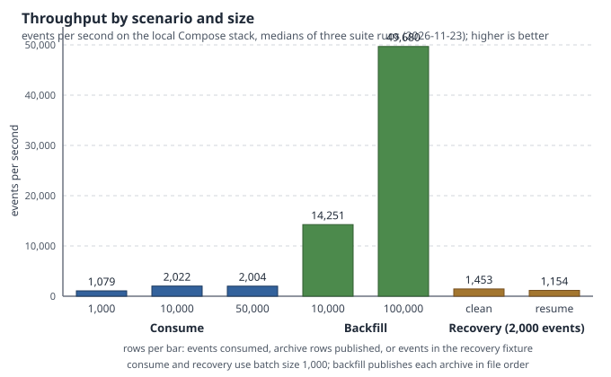

# Performance

Throughput is measured, not asserted. The numbers below are documentation from one machine: they never gate CI, no timing threshold exists anywhere in the tests, and another machine will measure different values. The measurements come from the opt-in perf suite, which drives the same Compose stack and fixtures as the integration suite:

```bash
docker compose --env-file /dev/null -p api-usage-it up -d --wait
USAGE_TEST_PERF=1 uv run --locked pytest -q -s tests/perf
```

Without `USAGE_TEST_PERF=1` the suite never runs: default runs do not collect it, and naming the file or a single test directly meets a module-level skip, both pinned by a unit test. The suite asserts structure only (exact outputs, exit codes, row and fact counts, ordering, positive durations), records every timing to a JSON report and prints the report path and the per-scenario lines (that is what the `-s` is for), and finishes in about two minutes. The method is recorded in detail in [ADR 0002](decisions/0002-performance-measurements.md); in short: every measured run gets a fresh topic and initialized database, a 1,000-event warmup per session is discarded (it can only warm the shared broker, PostgreSQL, and operating system caches, since every measured run is a fresh process), every scenario runs three times per session, and the table is the median of three suite executions (2026-11-23) with the range across all nine runs.

| Scenario | Events or rows | Median seconds | Range seconds | Throughput |
| --- | ---: | ---: | ---: | ---: |
| Consume to the high watermark, batch 1,000 | 1,000 | 0.93 | 0.81 to 1.06 | 1,079 events/s |
| Consume to the high watermark, batch 1,000 | 10,000 | 4.94 | 4.86 to 5.05 | 2,022 events/s |
| Consume to the high watermark, batch 1,000 | 50,000 | 24.95 | 24.91 to 25.49 | 2,004 events/s |
| Backfill (validate and publish all archives) | 10,000 | 0.70 | 0.68 to 0.74 | 14,251 rows/s |
| Backfill (validate and publish all archives) | 100,000 | 2.01 | 1.98 to 2.09 | 49,680 rows/s |
| Recovery clean run, 2,000 events | 2,000 | 1.38 | 1.31 to 1.62 | 1,453 events/s |
| Recovery after a kill at the first commit | 2,000 | 1.73 | 1.69 to 1.89 | 1,154 events/s |

The kill in the last row happens right after the first batch commits; the resumed process re-verifies and finishes the remaining 1,000 events, which adds about 0.36 seconds against the clean median. Two properties dominate these numbers. Consuming pays a roughly fixed half second per batch regardless of size, because each batch commits one transaction and performs its broker guard checks first; the per-event rate is flat between 10,000 and 50,000 events, and a one-off probe with the CLI's default batch of 100 spent more than 45 seconds on 10,000 events before its recording window ended, an order of magnitude below the batch-1,000 rates here. Publishing, which needs none of that, moves tens of thousands of rows per second. Every measured span also contains the fixed cost of one CLI process start, its connections, and the startup guards (about 0.44 seconds on this machine, the same arithmetic that gives the per-batch slope): it dominates the consume-1,000 and backfill-10,000 rows, and the backfill-100,000 span carries two of them because it publishes two archives.



The chart, the table, and [ADR 0002](decisions/0002-performance-measurements.md) were recorded by hand from the suite's JSON reports; rerun the suite to measure again, and amend them together so the published numbers keep one source.
